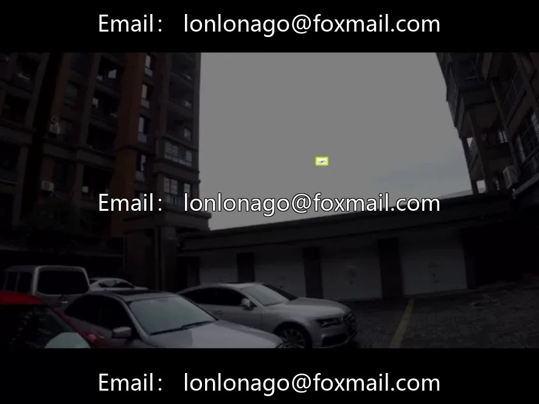
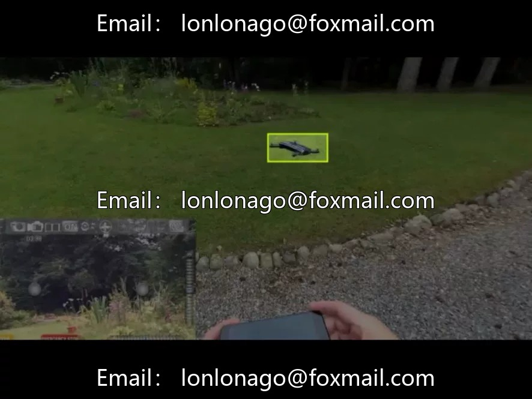
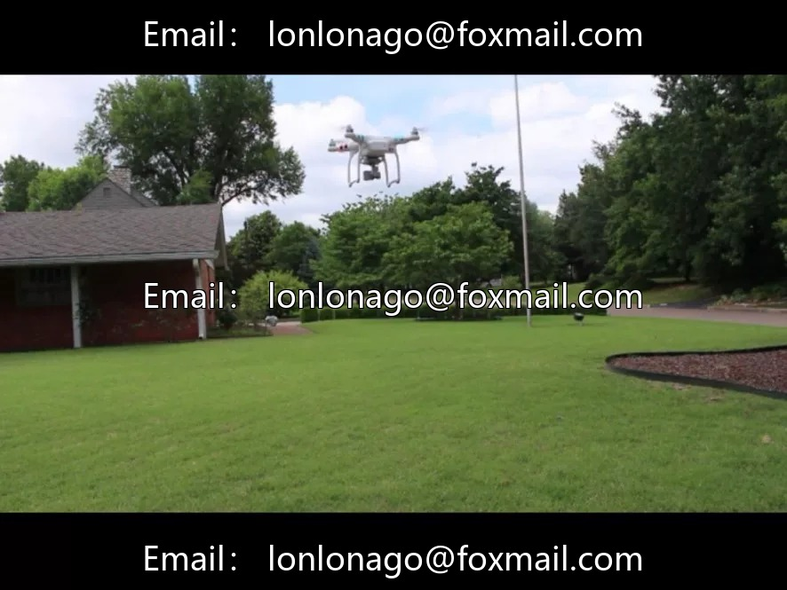
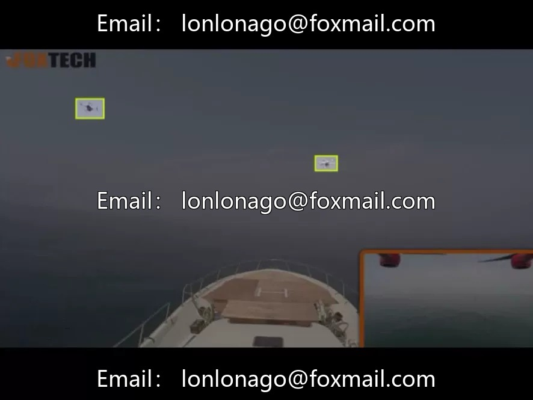
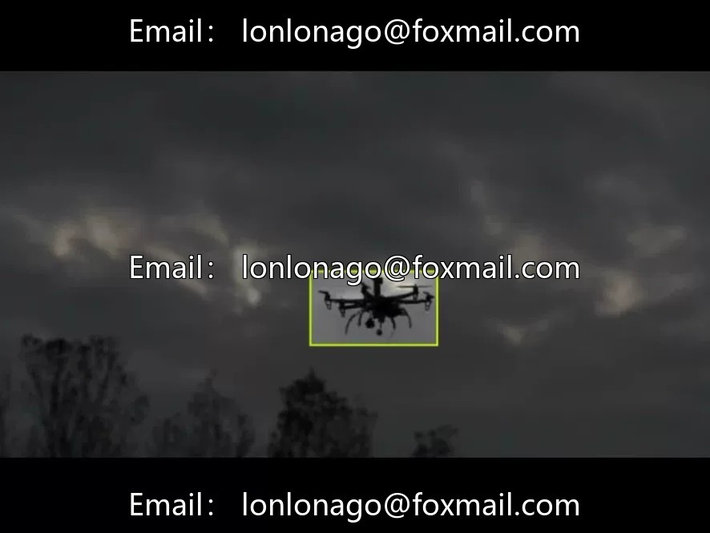
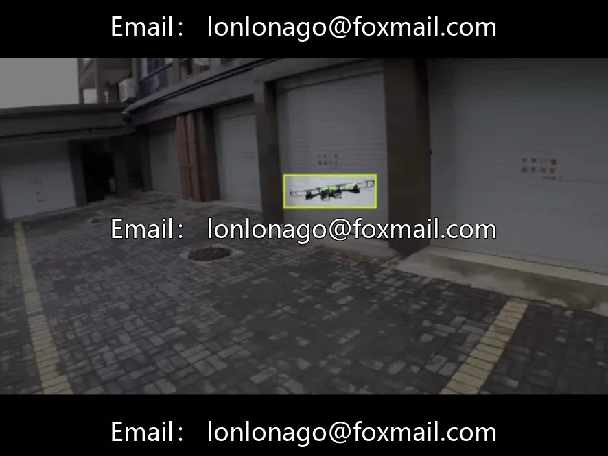
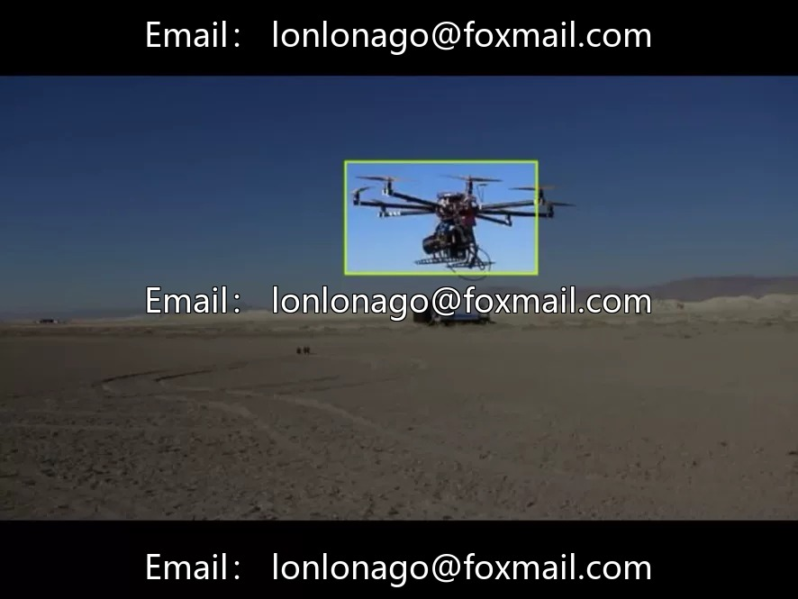

# Low-altitude UAV target detection dataset

## Body

Low-altitude UAV Object Detection Dataset (Anti-UAV/Airspace Ban Identification), Issue 10467
Comprising 2800 aerial images, focusing on the "UAV" single category target, suitable for scenarios such as airspace surveillance, anti-UAV systems, and aerial safety control. The dataset is labeled in YOLO format, with clear definitions of categories, highly matching the features of UAV entities, and without blurred boundaries. The scenes cover different flight altitudes and lighting conditions, demonstrating strong representativeness, suitable for algorithm research and small object detection tasks.

Virtual materials, once sold, are non-refundable.
Interested friends, click "I want" to proceed.

## Images

## Payment

Here is a pay link on Stripe ( https://buy.stripe.com/3cs8yP7sY87d0vu9AB ). Please contact me lonlonago@foxmail.com after funding $89, and I will send you a complete data files , thank you!

